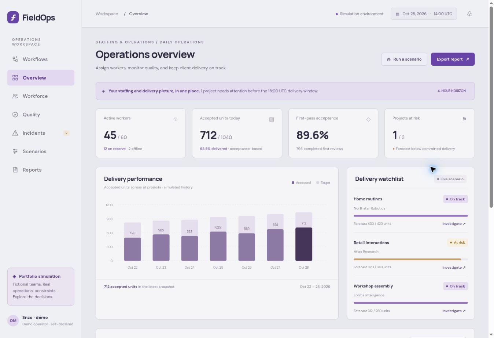
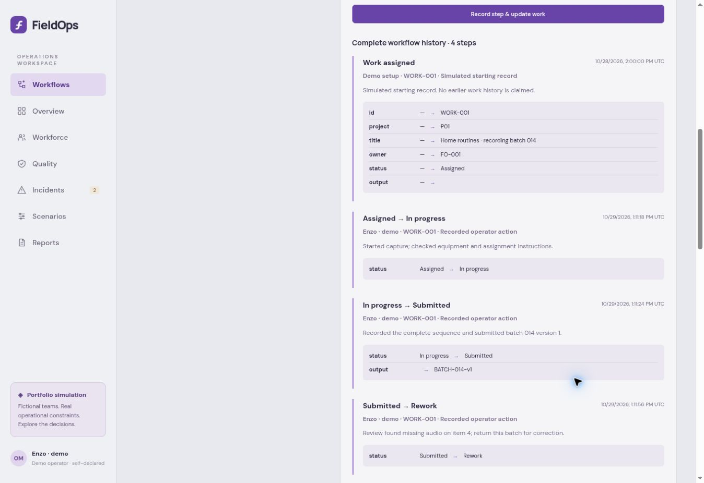
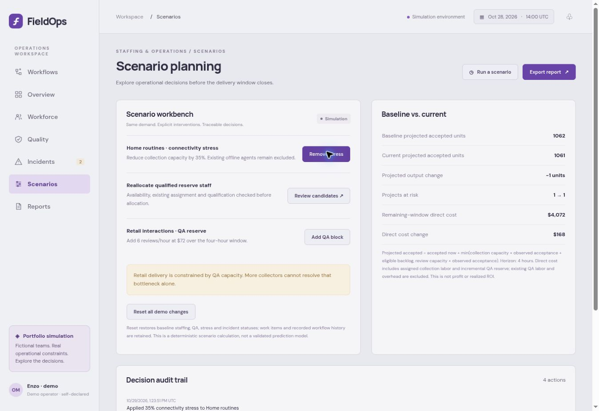

# FieldOps — Staffing & Operations Management

**Current release: v1.1.0 · October 29, 2026**  
Working browser prototype with simulated data. Owner acceptance is pending.

FieldOps connects staffing, quality, delivery risks and the history of individually identified work. Managers can inspect a deliverable's owner, execution, submissions, review decisions and rework, then trace operational changes to the recorded operator and before/after values.

The example client business collects recordings used to train AI. FieldOps itself uses deterministic rules and calculations; it does not run an autonomous AI model.

[ADLC](docs/ADLC.md) · [Flowcharts](docs/FLOWCHARTS.md) · [Changelog](CHANGELOG.md) · [v1.1.0 release](docs/releases/V1.1.0.md) · [v1.0.0 baseline](docs/releases/V1.0.0.md) · [Business case](docs/BUSINESS-CASE.md) · [Architecture](docs/ARCHITECTURE.md) · [Validation](docs/VALIDATION.md)

[Open hosted app](https://fieldops-ai.enzo-safadi.chatgpt.site/) — owner-private; requires the owner's ChatGPT access. The reviewed demonstration can also run locally.

## Current screenshots — v1.1.0

Authentic browser captures of the reviewed v1.1.0 source. All people, clients, work, costs and results are simulated. SS1 and SS3 illustrate different explicitly described scenario states.

### SS1 — Operations overview



Baseline staffing and delivery overview: 45 active workers, 712 historically accepted units and one project at risk. These are fixture values, not customer results.

### SS2 — Work-item workflow history



WORK-001 retains four steps: assignment, execution, submission with output reference, and review returning the work for rework. Operator, UTC time, notes and changed values remain visible. Operator names are self-declared demo identities.

### SS3 — Scenario comparison



This separate scenario assigns Lucia Martin to Home routines, adds one Retail QA block, and applies 35% Home connectivity stress. Current projected output is 1,061 versus the 1,062-unit baseline; modeled remaining-window direct cost is $4,072, up $168. The adverse scenario is shown honestly: an intervention does not guarantee a net improvement.

[Capture details and reproduction steps](docs/SCREENSHOTS.md)

## What works in v1.1.0

- Seven workspaces: Workflows, Overview, Workforce, Quality, Incidents, Scenarios and Reports.
- Individually identified deliverables with qualified owners and controlled execution, submission, review, rework and final-outcome transitions.
- Structured operator/time/project/record history with notes and before/after snapshots; filters and workflow-history CSV export.
- Eligibility-checked reserve staffing, bounded QA capacity, incident coordination and deterministic scenario comparison.
- Validated JSON workspace backups, restore preview/confirmation, damaged-save preservation and explicit storage-failure messages.
- Staffing-scenario reset retains work items and earlier decisions. Browser-data clearing and backup replacement have different consequences; export before replacing data.

## Follow one deliverable

1. Open **Workflows**, set a demo operator name and select a work item.
2. Record **In progress**, describing the work performed.
3. Record **Submitted** with a note and output reference.
4. Review it as **Accepted**, **Rework** or **Rejected**. Rework returns through execution and submission; previous steps remain.
5. Inspect per-item history, filter the cross-record explorer, or export the workflow CSV.
6. Open **Reports** to download a complete workspace backup before replacing a scenario.

[Workflow guide and limits](docs/WORKFLOW-HISTORY.md)

## ADLC and version control

The ADLC connects business requirements, design decisions, implementation, tests, release documentation and owner review. [See its flowchart](docs/FLOWCHARTS.md#adlc--ai-development-lifecycle).

The exact previous source is preserved in [releases/v1.0.0](https://github.com/enzosafadi/FieldOps/tree/releases/v1.0.0). Its [gallery](https://github.com/enzosafadi/FieldOps/tree/releases/v1.0.0/docs/screenshots) and original [presentation](https://github.com/enzosafadi/FieldOps/blob/releases/v1.0.0/docs/presentation/FieldOps-Project-Presentation.pdf) document the earlier white/green design. They are historical evidence, not current screenshots. The v1.1.0 feature baseline is preserved in [releases/v1.1.0](https://github.com/enzosafadi/FieldOps/tree/releases/v1.1.0); subsequent documentation/media updates on main do not change its application behavior.

## Run locally

Python 3 serves the static files; Node.js runs validation. No API key or dependency installation is needed.

```bash
python3 -m http.server 8080 --directory dist
# Open http://localhost:8080
node tests/model.test.mjs
node --test tests/workspace.test.mjs tests/workflow.test.mjs
```

## Scope and limits

Browser-local simulated prototype. There are no verified team accounts, shared database, server-enforced permissions, tamper-proof retention or production integrations. Local data and imported backups can be edited. Work records illustrate lifecycle tracking independently of the fixed aggregate delivery snapshot. Output references do not upload or verify files. Forecasts use a four-hour deterministic model; existing QA labor and overhead are excluded from scenario costs. Mobile layout exists, but full mobile viewport verification remains pending.

Source and documentation distinguish implemented features, simulated outcomes and future work. No real client results, financial savings or production acceptance are claimed.
