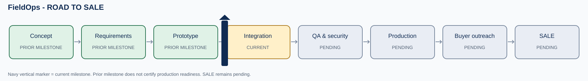
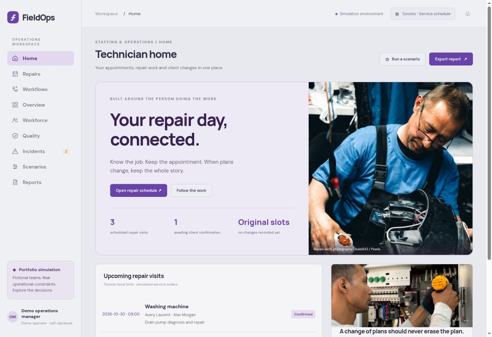
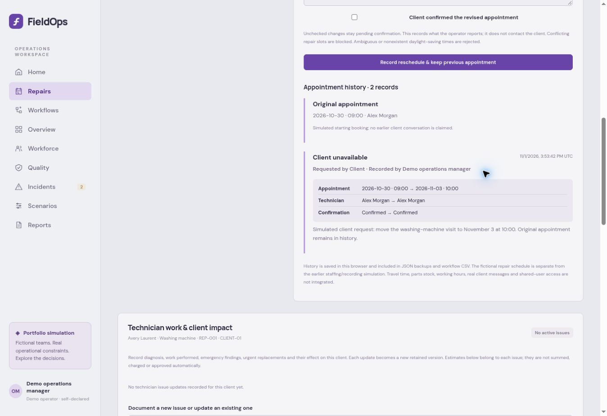
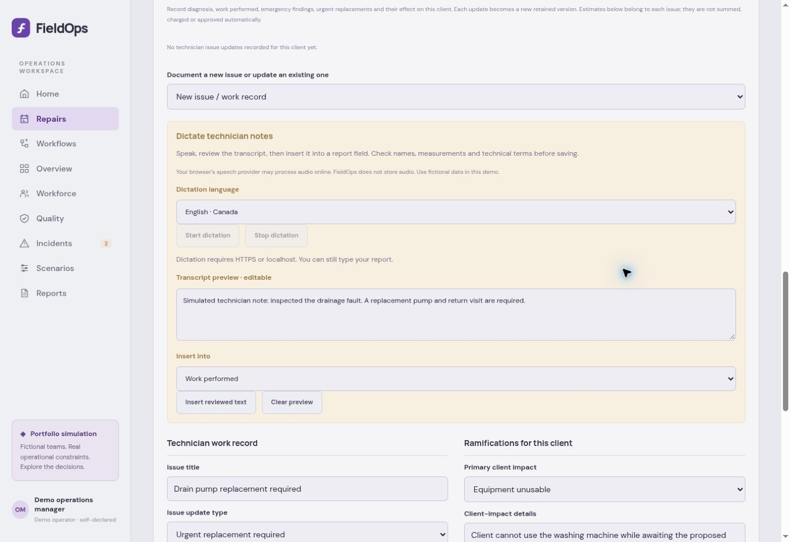
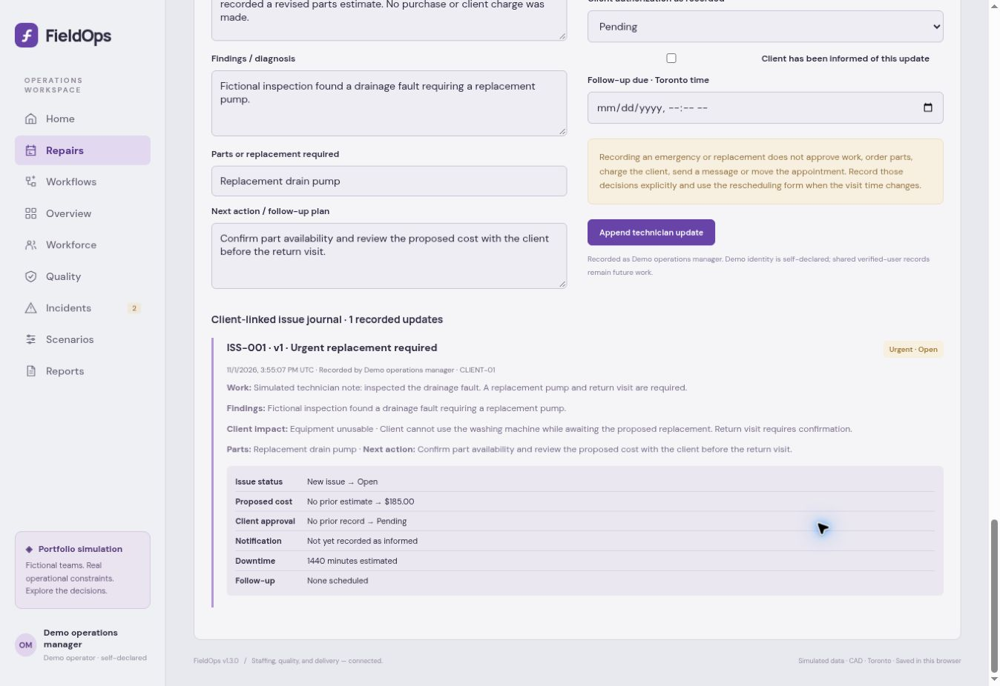

# FieldOps — Technician Work & Operations

## Project roadmap — concept to sale



**Current release: v1.3.0 · November 1, 2026**  
Working browser prototype with simulated records; owner acceptance pending.

FieldOps now puts a technician's repair day first: appointments, client-requested changes, documented work, emergencies, urgent replacements and the consequences for each client. Earlier staffing/quality/delivery workspaces remain available as a separate deterministic simulation.

[Open owner-private app](https://fieldops-ai.enzo-safadi.chatgpt.site/) · [AI strategy & operating model](docs/AI-STRATEGY-AND-OPERATING-MODEL.md) · [ADLC](docs/ADLC.md) · [Changelog](CHANGELOG.md) · [v1.3.0 notes](docs/releases/V1.3.0.md) · [Repair/client-impact guide](docs/REPAIRS-AND-CLIENT-IMPACT.md) · [Flowcharts](docs/FLOWCHARTS.md) · [Validation](docs/VALIDATION.md)

## Current product and commercial status

[Product brief and pilot-readiness matrix](docs/PRODUCT-READINESS.md) · [Introduction / who benefits](docs/INTRODUCTION.md) · [Current business case](docs/BUSINESS-CASE.md) · [Delivery and acceptance status](docs/PROJECT-CLOSEOUT.md)

The next commercial step is a focused pilot after discovery and production-foundation work. This browser-local prototype is not yet a turnkey team system. No customer adoption, reporting-time savings or sales interest is claimed.

## Current release screenshots — v1.3.0

### SS1 — Technician home



### SS2 — Original and revised appointment



### SS3 — Reviewed report preview



The preview text was typed for the screenshot. Dictation is blocked on the HTTP preview's security context. This image demonstrates the controls and typing fallback, not successful microphone transcription.

### SS4 — Client-linked work record



All records are fictional. The capture states and limits are in [screenshot evidence](docs/SCREENSHOTS.md). The pictured repair worker is credited stock imagery, not an assigned technician or endorsement.

## What v1.3.0 adds

Voice-assisted technician reporting in English and French. Dictate into an editable preview, select a report field, insert reviewed text, then save the technician update. Browser support and microphone permission are required; typing stays available. [Voice reporting guide](docs/VOICE-REPORTING.md) · [v1.3.0 notes](docs/releases/V1.3.0.md). The current SS1–SS4 gallery is v1.3.0. Archived galleries describe earlier releases. The eight-slide presentation is historical v1.0.0 evidence.

## What v1.2.0 adds

- Technician-centered Home and Repairs: nine workspaces in total.
- Nine rescheduling reasons with requester, recorder, notes, original/revised times and confirmation.
- Twenty-five technician update types covering diagnosis, work performed, emergencies, urgent replacements, parts, temporary repairs, approval, return visits and closure.
- Client-linked issue versions retaining findings, work, parts, next action, priority/status, service impact, downtime, proposed additional CAD cost and recorded notification/authorization.
- Toronto appointment validation, technician overlap checks and explicit rejection of ambiguous/nonexistent DST times.
- Complete service history in validated JSON backups; concise event summaries in workflow CSV.
- Staffing reset retains repair and issue records. No automatic charges, purchases, messages or rescheduling from an issue report.

## Try the service workflow

1. Open Home → a repair visit.
2. Reschedule explicitly using the revised time, reason and client confirmation.
3. Scroll to Technician work & client impact; create an issue with findings, work and client ramifications.
4. Append another update to that same issue; inspect the preserved earlier version.
5. Return Home to inspect unresolved emergencies. Download a JSON workspace backup under Reports.

[Detailed usage and all update categories](docs/REPAIRS-AND-CLIENT-IMPACT.md)

## Preserved versions

v1.0.0 and v1.1.0 are preserved under their release branches. Their screenshots and original presentation remain historical evidence and are not labeled as current media. See [release history](docs/releases) and [changelog](CHANGELOG.md).

Earlier recording/staffing functionality remains available: 60 fictional workers, eligibility-checked reserve assignments, QA limits, incident coordination, deterministic forecasts and reports. Recording a repair or client-impact update does not rewrite those historical aggregate metrics.

## Run locally

```bash
python3 -m http.server 8080 --directory dist
# Open http://localhost:8080
node --test tests/*.test.mjs
```

No API key or dependency install is required. [Architecture](docs/ARCHITECTURE.md) · [Business case](docs/BUSINESS-CASE.md)

## Scope and limits

Browser-local simulated prototype with three repair orders and three service technicians. No arbitrary real customer/order creation or import, attachments, verified team identities, shared protected storage, real parts stock, billing/purchasing, live client messaging or production integrations. Operator names and recorded approvals are self-declared. Estimates are per issue and are not summed into invoices. Generic CSV exports concise issue summaries; complete findings/impact history is in the client journal and JSON backups. Full mobile viewport and real multiuser validation remain pending.

All people, clients, work, estimates and outcomes are fictional. FieldOps uses deterministic rules; the earlier example industry's AI recordings do not imply the app runs an autonomous AI model.


## Data readiness and planned grounding

[Five data-quality checks and implementation gaps](docs/DATA-READINESS.md): accuracy, relevance, timeliness, cleanliness and availability. Existing structural validation and technician review are implemented; generative report grounding, factual verification, freshness monitoring and shared permissions remain planned.


## Repository verification

[Current scoped verification results](VERIFICATION.md). Run `python tools/verify_repository.py --visibility public`.
