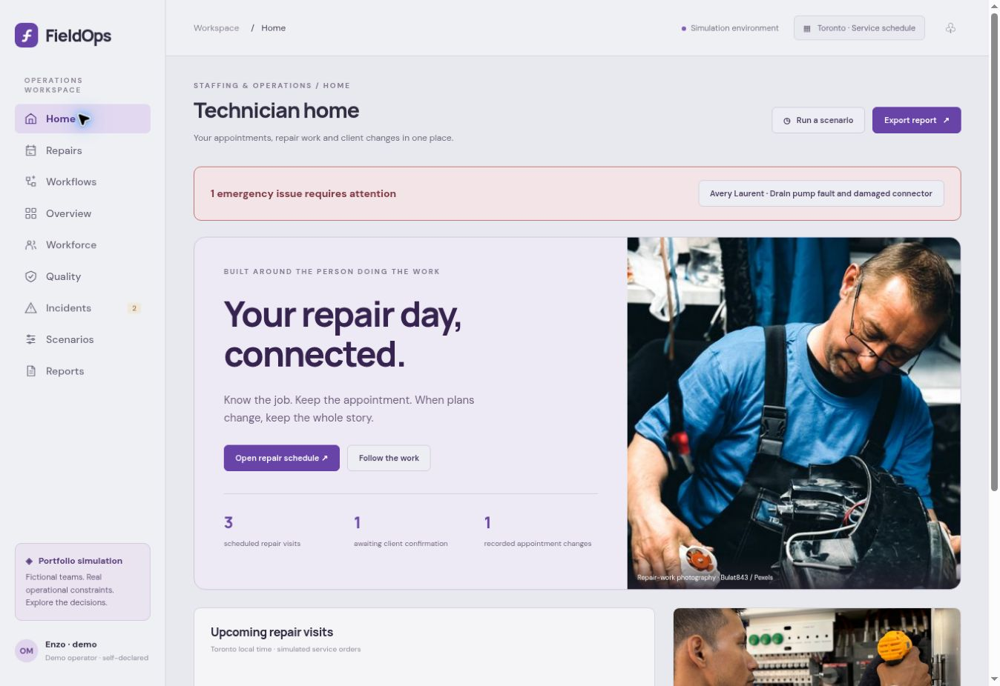
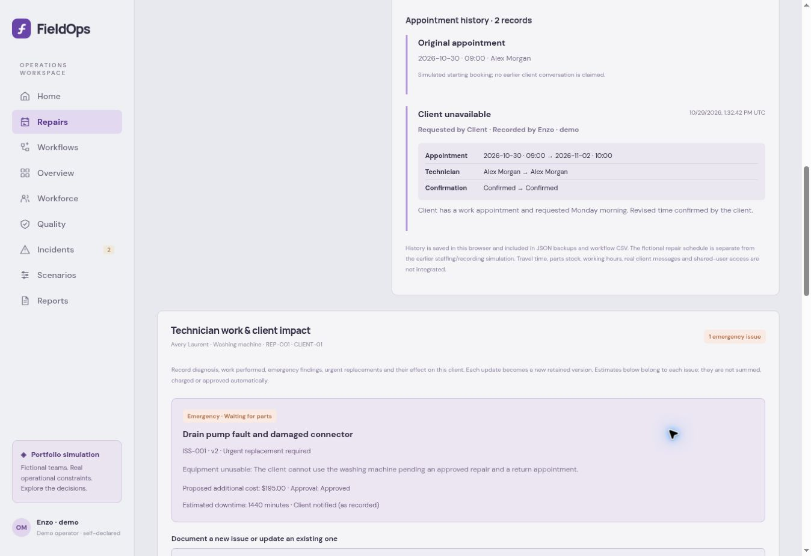
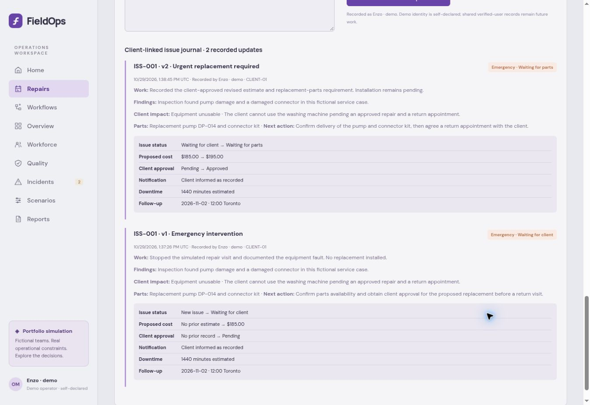

# FieldOps — Technician Work & Operations

**Current release: v1.2.0 · October 29, 2026**  
Working browser prototype with simulated records; owner acceptance pending.

FieldOps now puts a technician's repair day first: appointments, client-requested changes, documented work, emergencies, urgent replacements and the consequences for each client. Earlier staffing/quality/delivery workspaces remain available as a separate deterministic simulation.

[Open owner-private app](https://fieldops-ai.enzo-safadi.chatgpt.site/) · [ADLC](docs/ADLC.md) · [Changelog](CHANGELOG.md) · [v1.2.0 notes](docs/releases/V1.2.0.md) · [Repair/client-impact guide](docs/REPAIRS-AND-CLIENT-IMPACT.md) · [Flowcharts](docs/FLOWCHARTS.md) · [Validation](docs/VALIDATION.md)

## Current screenshots — v1.2.0

### SS1 — Technician home



Real repair-work photography supports visit cards and an attention link for a fictional unresolved emergency. The pictured person is stock imagery, not an assigned technician or endorsement.

### SS2 — Appointment history and client impact



The original booking remains alongside the client's revised appointment, reason, operator and confirmation. Client-specific replacement/downtime/cost consequences are visible below.

### SS3 — Versioned technician work and ramifications



The second update retains the first: CAD185/Pending and CAD195/Approved-as-recorded remain in the same client's history. These are fictional estimates and reported approval statuses, not real invoices or verified authorizations.

[Exact capture states and reproduction](docs/SCREENSHOTS.md) · [Image sources and credits](docs/ASSET-CREDITS.md)

## What v1.2.0 adds

- Technician-centered Home and Repairs: nine workspaces in total.
- Nine rescheduling reasons with requester, recorder, notes, original/revised times and confirmation.
- Twenty-five technician update types covering diagnosis, work performed, emergencies, urgent replacements, parts, temporary repairs, approval, return visits and closure.
- Client-linked issue versions retaining findings, work, parts, next action, priority/status, service impact, downtime, proposed additional CAD cost and recorded notification/authorization.
- Toronto appointment validation, technician overlap checks and explicit rejection of ambiguous/nonexistent DST times.
- Complete service history in validated JSON backups; concise event summaries in workflow CSV.
- Staffing reset retains repair and issue records. No automatic charges, purchases, messages or rescheduling from an issue report.

## Try the service workflow

1. Open Home → a repair visit.
2. Reschedule explicitly using the revised time, reason and client confirmation.
3. Scroll to Technician work & client impact; create an issue with findings, work and client ramifications.
4. Append another update to that same issue; inspect the preserved earlier version.
5. Return Home to inspect unresolved emergencies. Download a JSON workspace backup under Reports.

[Detailed usage and all update categories](docs/REPAIRS-AND-CLIENT-IMPACT.md)

## Preserved versions

v1.0.0 and v1.1.0 are preserved under their release branches. Their screenshots and original presentation remain historical evidence and are not labeled as current media. See [release history](docs/releases) and [changelog](CHANGELOG.md).

Earlier recording/staffing functionality remains available: 60 fictional workers, eligibility-checked reserve assignments, QA limits, incident coordination, deterministic forecasts and reports. Recording a repair or client-impact update does not rewrite those historical aggregate metrics.

## Run locally

```bash
python3 -m http.server 8080 --directory dist
# Open http://localhost:8080
node --test tests/*.test.mjs
```

No API key or dependency install is required. [Architecture](docs/ARCHITECTURE.md) · [Business case](docs/BUSINESS-CASE.md)

## Scope and limits

Browser-local simulated prototype with three repair orders and three service technicians. No arbitrary real customer/order creation or import, attachments, verified team identities, shared protected storage, real parts stock, billing/purchasing, live client messaging or production integrations. Operator names and recorded approvals are self-declared. Estimates are per issue and are not summed into invoices. Generic CSV exports concise issue summaries; complete findings/impact history is in the client journal and JSON backups. Full mobile viewport and real multiuser validation remain pending.

All people, clients, work, estimates and outcomes are fictional. FieldOps uses deterministic rules; the earlier example industry's AI recordings do not imply the app runs an autonomous AI model.
