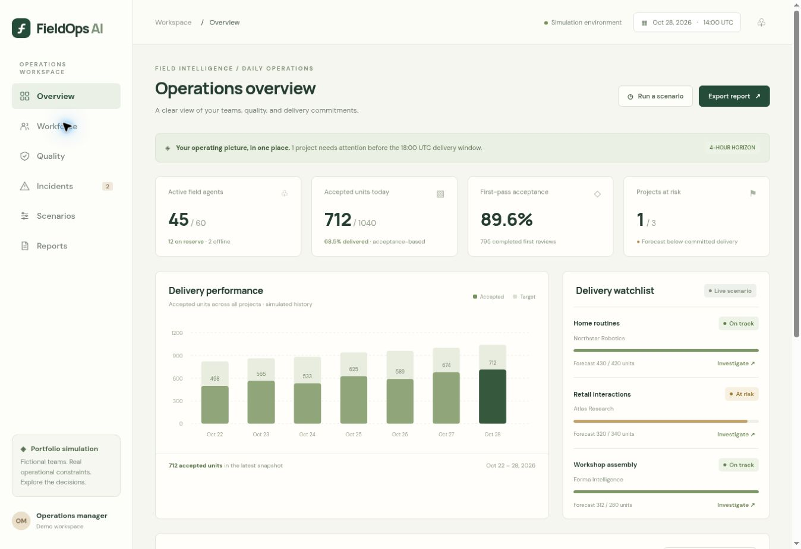
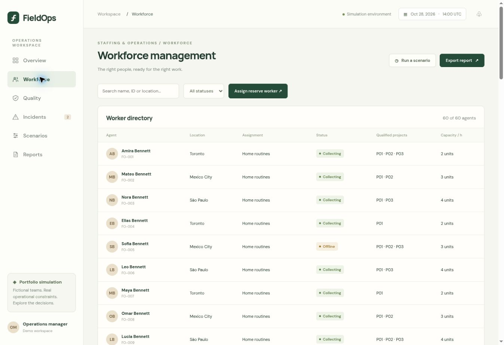
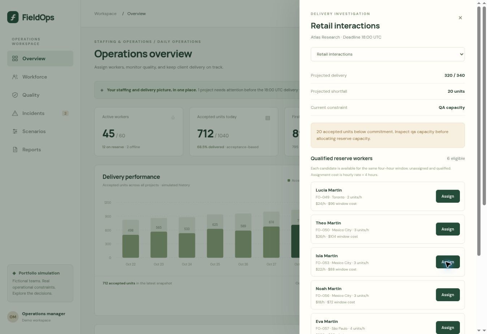
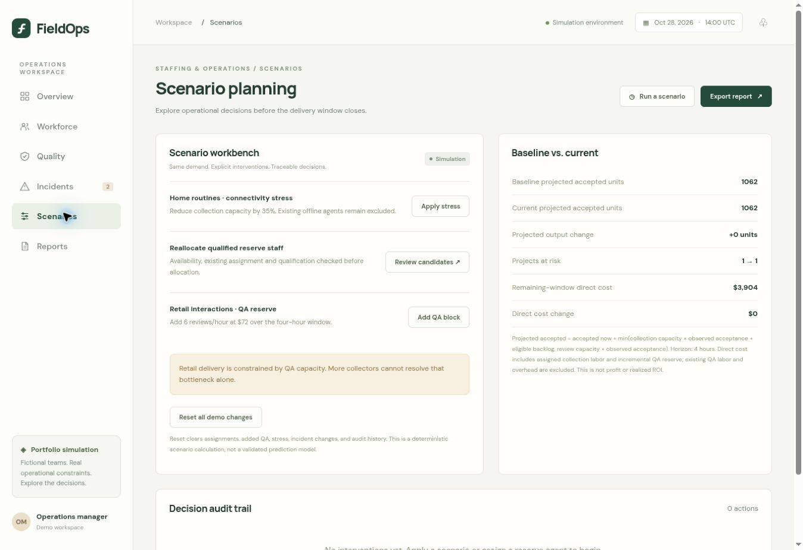
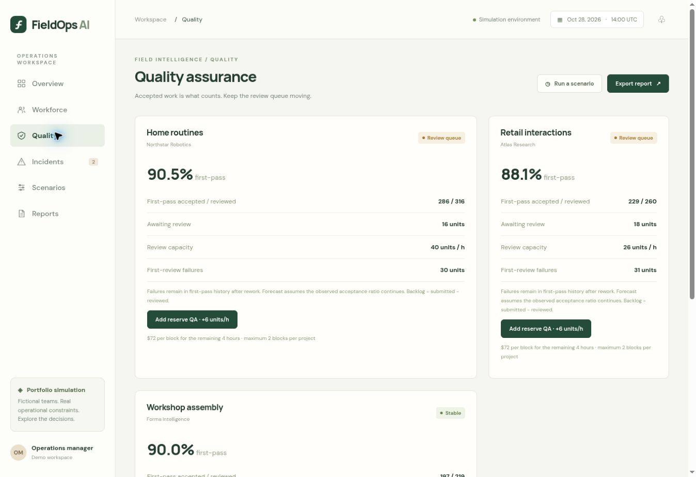
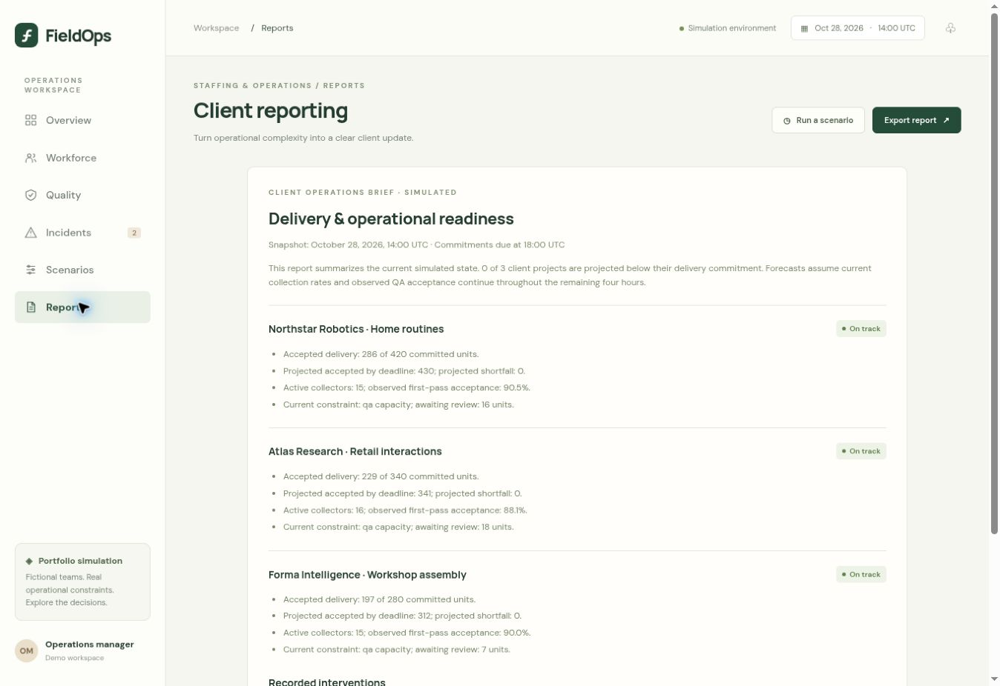
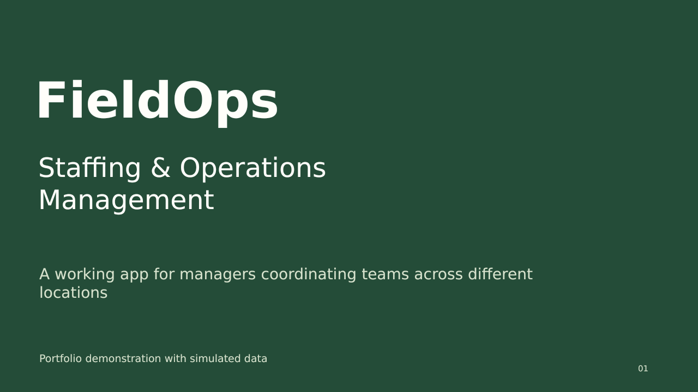

# FieldOps v1.1.0

Current release: **1.1.0 — October 29, 2026**. Browser-local simulated prototype; owner acceptance pending.

Adds complete per-deliverable workflow histories, operator attribution, before/after operational records, validated backup/recovery and a light-gray/violet interface. Shared verified-user storage and protected retention remain future work.

- [Changes in v1.1.0](CHANGELOG.md)
- [ADLC — requirements, decisions, tests and release gates](docs/ADLC.md)
- [Previous version v1.0.0 and exact source baselines](docs/releases/V1.0.0.md)
- [Current release notes](docs/releases/V1.1.0.md)
- [Workflow usage and limitations](docs/WORKFLOW-HISTORY.md)

The earlier gallery and presentation below document **v1.0.0**, including its original white/green design. They are retained as historical evidence and do not depict the latest release.

---

# FieldOps

### Staffing & Operations Management

**Status: completed portfolio prototype, version 1.0.**

An interactive staffing and operations app for teams working across different locations. Assign available workers to projects, monitor quality checks, identify delivery risks, and compare the cost of corrective actions.

The example business collects recordings used to train AI. That is the client industry: FieldOps itself uses predefined rules and calculations, with managers making staffing decisions.

**All data and outcomes are simulated.** This is an independent portfolio project, not actual client work.

[Open hosted app](https://fieldops-ai.genialmoose17.chatgpt.site) · [Business case](docs/BUSINESS-CASE.md) · [Introduction](docs/INTRODUCTION.md) · [Architecture](docs/ARCHITECTURE.md) · [Validation](docs/VALIDATION.md) · [Presentation PDF](docs/presentation/FieldOps-Project-Presentation.pdf) · [PowerPoint](docs/presentation/FieldOps-Project-Presentation.pptx)

The hosted app is owner-private and requires the owner's ChatGPT access. The reviewed demo source in this repository can also be run locally.

## Operations overview



## Try a real operational decision

1. Open **Retail interactions → Investigate**. Baseline forecast is 320 accepted units against a 340-unit commitment.
2. Assign Lucia Martin (FO-049), a qualified reserve worker. Collection capacity increases; the QA-constrained forecast stays at 320.
3. Add a QA reserve block. Forecast reaches 341 accepted units; recorded direct cost rises by $168 for the illustrated collector and QA intervention.
4. Open **Scenarios** to inspect baseline comparison and the decision audit. Apply connectivity stress to see a different constraint emerge.
5. Open **Reports** to export the current scenario as CSV, or print it to PDF. Reset the demo from Scenarios when finished.

These are deterministic simulation results, not realized savings or measured client outcomes.

## Staffing and investigation





## Scenario planning



## Quality assurance



## Client reporting



## Project presentation

[](docs/presentation/FieldOps-Project-Presentation.pdf)

[Read the presentation](docs/presentation/FieldOps-Project-Presentation.pdf) or [download the editable PowerPoint](docs/presentation/FieldOps-Project-Presentation.pptx).

[Five-minute walkthrough](docs/DEMO-WALKTHROUGH.md) · [Project closeout and scope](docs/PROJECT-CLOSEOUT.md)

## What works

- Six workspaces: overview, searchable workforce, QA, incidents, scenario planning, and client reports.
- 60 fictional workers across three locations and three projects.
- Assignment validation for availability, qualifications, and overlapping assignment within one shared shift window.
- Capacity-constrained delivery forecasts, added QA cost, connectivity stress, and immutable historical acceptance metrics.
- Incident status transitions, browser-local persistence, reset, and action audit trail.
- CSV export, print styling, keyboard-accessible investigation drawer, and responsive navigation.

## Run locally

Requires Python 3 for a static server, and Node.js for model checks. No package install or API key is required.

```bash
python3 -m http.server 8080 --directory dist
# Open http://localhost:8080
node tests/model.test.mjs
```

Source: `dist/index.html`, `dist/style.css`, `dist/app.mjs`, `dist/model.mjs`. Serve over HTTP rather than opening index.html directly because the app uses ES modules.

## Scope and limits

This is a browser-based operational prototype with deterministic simulation and local storage. It has no shared database, real video collection, connected workforce system, or validated predictive model. Each scenario uses the same four-hour window. Historical data is a fictional snapshot with seven daily aggregates, not a generated 90-day event stream. Existing QA labor and overhead are excluded from the remaining-window direct-cost comparison, so that number is not profit or total operating cost.

A separate private repository retains development materials. This public repository contains the reviewed reproducible demo, business case, introduction, validation notes and screenshots.
