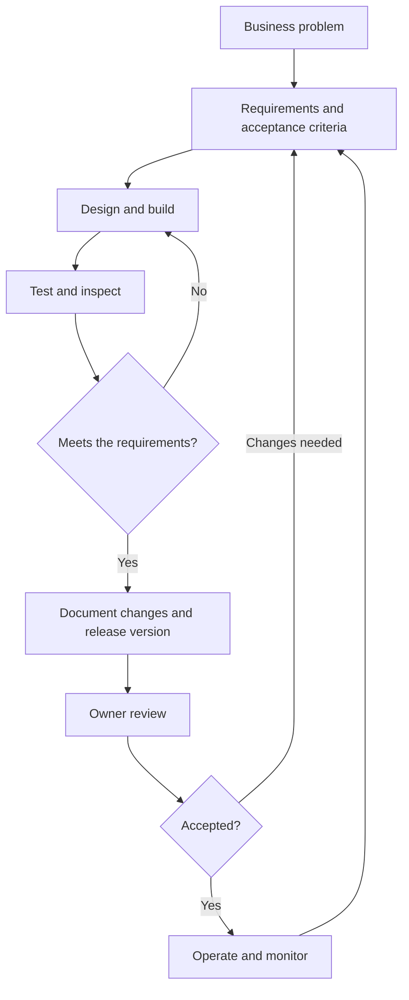
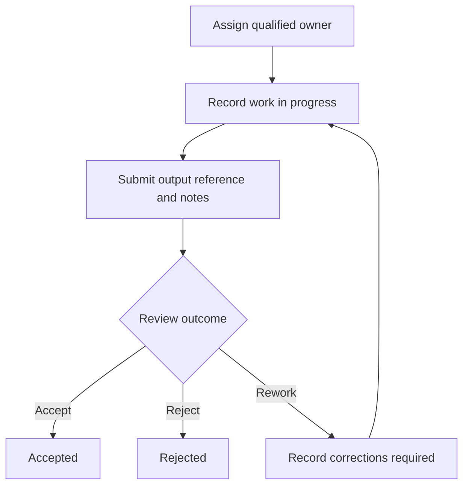

# FieldOps v1.1.0 — Flowcharts

## ADLC — AI Development Lifecycle

Current position: v1.1.0 has passed its recorded checks and been deployed owner-private. Owner review is pending. Commercial operation and monitoring are future stages, not completed milestones. See [ADLC](ADLC.md) for the requirements/evidence matrix and limitations.

## Work-item workflow

Each recorded transition retains operator, timestamp, work/project IDs, notes and before/after values. Previous steps remain visible after rework. Operator identity and history are browser-local demo data; authenticated shared retention is not implemented.
